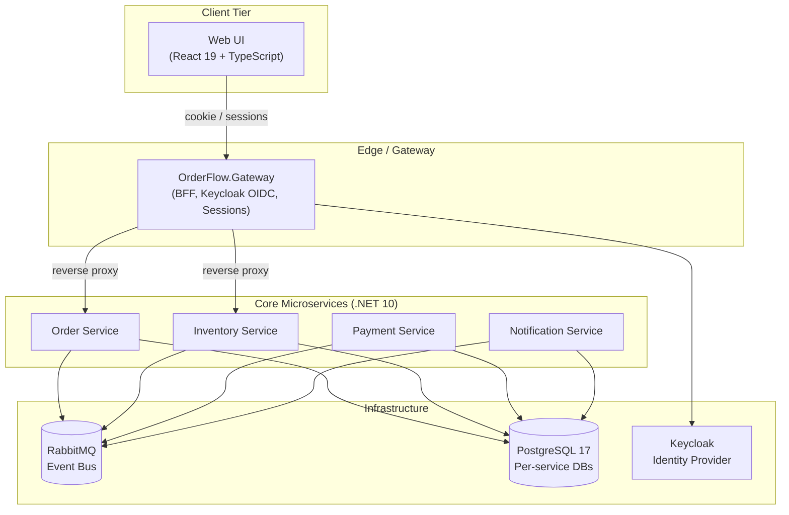

<div align="center">

# 📦 OrderFlow

### Event-driven order processing platform built with .NET 10 microservices, RabbitMQ, PostgreSQL, Keycloak, and Spec-Driven Development (SDD)

[](https://github.com/akazad13/order-flow/actions)
[](https://dotnet.microsoft.com/)
[](https://react.dev/)
[](https://www.typescriptlang.org/)
[](https://www.rabbitmq.com/)
[](https://www.postgresql.org/)
[](https://www.keycloak.org/)
[](LICENSE)

[Overview](#-overview) •
[Architecture](#-architecture) •
[Tech Stack](#-tech-stack) •
[Repository Layout](#-repository-layout) •
[Quick Start](#-quick-start) •
[Testing](#-testing) •
[Spec-Driven Development](#-spec-driven-development-workflow)

</div>

---

## 📌 Overview

**OrderFlow** is an event-driven order processing platform built to practice and demonstrate **Spec-Driven Development (SDD)**: every feature begins with a formal specification, contracts and Gherkin scenarios are defined and linted first, and every acceptance criterion maps to automated tests across unit, contract (Pact), integration (Testcontainers), and E2E (Playwright) layers.

### Key Highlights
- 🔄 **Asynchronous Event Collaboration**: Decoupled domain services communicate via RabbitMQ with durable messaging, error queues, and dead-letter handling.
- 📜 **Consumer-Driven Contracts**: HTTP contracts between Web UI and Order API are enforced with Pact, alongside OpenAPI (Spectral) and AsyncAPI linting gates.
- 🔐 **BFF Security Model**: Keycloak handles user identity; tokens are securely held at the Gateway BFF, presenting an HttpOnly session cookie to the browser.
- 📐 **Rigorous Quality Gates**: Contract-gate scripts (`check-contracts.mjs`) block breaking API changes, and spec gates (`check-specs.mjs`) verify that specs, plans, and tests stay aligned.

---

## 🏛 Architecture



> [!NOTE]
> Each service owns its dedicated database schema (`orders`, `inventory`, `payments`, `notifications`), maintaining strict domain boundaries.

---

## 🛠 Tech Stack

| Domain | Technologies |
| :--- | :--- |
| **Backend Services** | .NET 10, ASP.NET Core, C# 14 (Order, Inventory, Payment, Notification, Gateway) |
| **Frontend** | React 19, TypeScript, OpenAPI-generated API clients |
| **Messaging & Broker** | RabbitMQ (AMQP), MassTransit / custom handlers |
| **Persistence** | PostgreSQL 17, Entity Framework Core 10, in-memory test providers |
| **Identity & Access** | Keycloak, OpenID Connect, OAuth 2.0, HttpOnly cookie sessions |
| **Quality & Contracts** | Pact, Spectral (OpenAPI lint), AsyncAPI CLI, Reqnroll (Gherkin), Testcontainers, Playwright |

---

## 📂 Repository Layout

```text
├── .specify/             # Project rules, spec/plan/task templates
├── specs/                # Feature folders (000-walking-skeleton/, spec.md, plan.md, tasks.md)
├── contracts/            # OpenAPI (HTTP), AsyncAPI + JSON Schema (events), Realtime hub
├── pacts/                # Consumer-driven contract definitions (Pact)
├── features/             # Gherkin feature files: component/ (Reqnroll) and e2e/ (playwright-bdd)
├── docs/                 # Architecture decision records (docs/adr/) and SDD retrospective
├── scripts/              # Automated spec gate and contract verification scripts
├── src/                  # .NET 10 services (Order, Inventory, Payment, Notification, Gateway)
├── tests/                # Unit, component, contract, and integration test suites
├── web/                  # React + TypeScript frontend application
└── e2e/                  # Playwright end-to-end browser test suites
```

---

## 🚀 Quick Start

### Prerequisites
- [.NET 10 SDK](https://dotnet.microsoft.com/)
- [Node.js 22+](https://nodejs.org/)
- [Docker Desktop](https://www.docker.com/)

### 1. Run the Development Stack
```bash
docker compose up -d --build --force-recreate
```

### 2. Service Endpoints
| Service | URL | Credentials / Notes |
| :--- | :--- | :--- |
| **Web UI** | `http://localhost:5180` | `alice` / `alice` (Customer), `sam` / `sam` (Staff), `ada` / `ada` (Admin) |
| **Keycloak Admin** | `http://localhost:8180` | `admin` / `admin` (Realm: `orderflow`) |
| **Gateway BFF** | `http://localhost:5105` | Entry point for browser API requests |
| **Order API** | `http://localhost:5101` | Core order operations |
| **Inventory API** | `http://localhost:5102` | Stock queries and admin updates |
| **Payment API** | `http://localhost:5103` | Payment processing |
| **Notification API** | `http://localhost:5104` | Simulated notifications inbox |
| **RabbitMQ Management** | `http://localhost:15672` | `guest` / `guest` |
| **PostgreSQL** | `localhost:5432` | `orderflow` / `orderflow` |

### 3. Local Frontend Development
```bash
npm --prefix web run dev
```
Runs the Vite dev server at `http://localhost:5173`, proxying `/bff` and APIs to the Gateway at port 5105.

---

## 🧪 Testing

| Test Suite | Purpose | Command |
| :--- | :--- | :--- |
| **Unit & Component Tests** | Fast .NET unit tests without Docker | `dotnet test OrderFlow.slnx --filter "Category!=Integration"` |
| **Integration Tests** | Real PostgreSQL & RabbitMQ via Testcontainers | `dotnet test OrderFlow.slnx --filter "Category=Integration"` |
| **Pact Contract Tests** | Consumer contract verification | `npm --prefix web test` |
| **Contract Linting** | Spectral (OpenAPI) & AsyncAPI verification | `npm run lint:contracts` |
| **Spec Gate** | Verify specs, plans, features, and forbidden dependencies | `npm run check:specs` |
| **Breaking Change Gate** | Detect unversioned breaking contract changes (`oasdiff`) | `npm run check:contracts` |
| **End-to-End Tests** | Playwright browser tests against the full running stack | `cd e2e && npm test` |

---

## 📐 Spec-Driven Development Workflow

1. **Write Spec**: Copy templates from `.specify/templates/` into `specs/NNN-name/` and author `spec.md`.
2. **Draft Plan**: Author `plan.md` defining the criterion-to-test-layer mapping table.
3. **Contracts & Scenarios First**: Update `contracts/` and Gherkin feature files, lint them, and observe failures.
4. **Implement Test-First**: Complete tasks in `tasks.md`, naming each test according to the plan table.
5. **Generate API Client**: Run `npm --prefix web run gen:api` to regenerate TypeScript types from OpenAPI schemas.
6. **Pass Spec Gate**: Run `npm run check:specs` before marking the feature as Done.

---

## 👤 Author

**Md. Abul Kalam**
- GitHub: [@akazad13](https://github.com/akazad13)
- LinkedIn: [Md. Abul Kalam](https://linkedin.com/in/akazad13)

---

## 📄 License

This project is licensed under the [MIT License](LICENSE).
