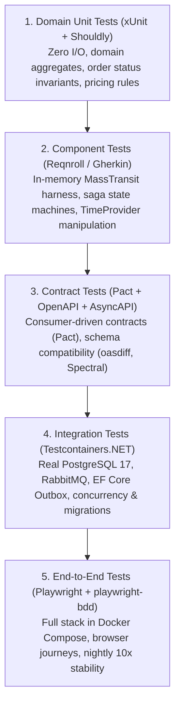

# Testing Paradigm & Strategy in OrderFlow

OrderFlow adheres to a strict **Spec-Driven Testing Paradigm** guided by the [Project Constitution](../.specify/memory/constitution.md) (Articles III and V) and battle-tested during the platform's architectural evolution (see [Retrospective](retro.md)).

---

## 1. Core Testing Philosophy

1. **Spec First & Acceptance Criterion Tracing**:
   - No test exists without a reason. Every test directly traces back to a numbered Acceptance Criterion (AC) in `specs/NNN-name/spec.md`.
   - `plan.md` maps every AC to a specific test layer and backticked test identifier (`Class.Method` or `feature.feature`).
   - The automated spec gate (`node scripts/check-specs.mjs`) enforces this alignment in CI on every push and pull request.

2. **Lowest Layer of Proof**:
   - Every behavior is verified at the lowest layer that can conclusively prove it.
   - Unit tests prove pure domain calculations and state invariants.
   - Component tests prove isolated service choreography and saga transitions.
   - Contract tests prove cross-boundary communication without end-to-end overhead.
   - Integration tests prove persistence, outbox mechanics, and broker behavior.
   - End-to-end tests prove full user journeys and distributed system stability under real load.

3. **Determinism — Zero Sleeps & Zero Silent Failures**:
   - **Never use fixed delays** (`Thread.Sleep`, `setTimeout`, arbitrary shell delays). All asynchronous assertions use condition polling with timeouts (`Eventually.cs`, Playwright auto-waits, MassTransit test harnesses).
   - **Per-test data isolation**: Every test generates unique identifiers (e.g. `Guid.NewGuid()`, unique customer IDs) so parallel runs never interfere.
   - **Zero Faulted Messages**: In end-to-end testing, no message may fail quietly. CI inspects RabbitMQ error and skipped queues (`check-error-queues.mjs`), failing the build if any message is trapped.

4. **Banned Dependencies**:
   - `Moq` is prohibited by workspace policy (use `NSubstitute`).
   - `AutoMapper` is prohibited (use explicit mapping or compile-time mappers like `Mapperly`).

---

## 2. The 5-Layer Test Pyramid



---

### Layer 1: Domain Unit Tests

- **Location**: `tests/OrderFlow.Order.UnitTests/`, `tests/OrderFlow.Inventory.UnitTests/`
- **Scope**: Core domain entities, value objects, domain logic, and state guards.
- **Execution**: Blazing fast (< 1 second), executed entirely in-memory with zero disk, network, or database I/O.
- **Tools**: `xUnit`, `Shouldly`, `NSubstitute`.
- **Example Targets**:
  - Validating order state machine transitions (e.g., cannot cancel an already shipped order).
  - Stock allocation arithmetic and shortage detection.
  - Price and total calculations.

---

### Layer 2: Component Tests (Gherkin & In-Memory Harness)

- **Location**:
  - Features: `features/component/*.feature`
  - Implementations: `tests/OrderFlow.*.ComponentTests/`
- **Scope**: Verifies an individual service meets its acceptance criteria in isolation.
- **Key Characteristics**:
  - Uses MassTransit's In-Memory Test Harness to simulate broker publish/consume cycles without external dependencies.
  - Uses `Microsoft.Extensions.TimeProvider.Testing` (`FakeTimeProvider`) to simulate timers, token expiration, and delayed retry policies deterministically without waiting real clock time.
  - Bound to human-readable Gherkin feature files via Reqnroll.
- **What it catches**:
  - Saga state machine choreography branches (e.g., `OrderStateMachine` receiving `PaymentFailed` vs `PaymentSucceeded`).
  - Idempotent consumer behavior upon duplicate event delivery.
  - Error queue dispatching when unhandled exceptions occur.

---

### Layer 3: Contract & Schema Verification Tests

- **Location**:
  - Consumer (Frontend): `web/src/api/*.pact.test.ts`
  - Provider (Backend): `tests/OrderFlow.Order.PactTests/`, `tests/OrderFlow.ContractTests/`
  - Contract Specs: `contracts/http/*.openapi.yaml`, `contracts/events/asyncapi.yaml`
- **Scope**: Guarantees that independent services (and frontend clients) agree on syntax and semantics without coupling their build pipelines.
- **Three Pillars of Contract Verification**:
  1. **Consumer-Driven Contracts (Pact)**:
     - React UI tests define exact request/response expectations using Vitest and `@pact-foundation/pact`, generating contract files under `pacts/`.
     - The .NET backend provider (`OrderFlow.Order.PactTests`) replays these pacts against the real controller endpoints, preventing breaking API drift.
  2. **Schema & Specification Linting**:
     - `Spectral` lints OpenAPI specs for schema correctness and naming standards.
     - `AsyncAPI CLI` validates event schema contracts and payload types against JSON Schema standards.
  3. **Breaking Change & Version Gate (`check-contracts.mjs`)**:
     - Compares branch contracts against git base (`oasdiff`).
     - Enforces semantic versioning: any change requires a version bump, and breaking changes require a major version bump.
     - Enforces that readers are deployed before publishers when event versions advance (ADR-0010).

---

### Layer 4: Integration Tests with Real Infrastructure (Testcontainers)

- **Location**: `tests/OrderFlow.*.IntegrationTests/`
- **Scope**: Data persistence, migrations, and transactional outbox behavior.
- **Execution**: Runs against ephemeral, production-identical Docker containers launched via `Testcontainers.NET` (`PostgreSqlContainer` and `RabbitMqContainer`).
- **Critical Invariants Tested**:
  - **Transactional Outbox Pattern**: Verifies that database updates and MassTransit outbox messages commit atomically in a single PostgreSQL transaction.
  - **Database Migrations**: Validates EF Core pending model changes (`dotnet ef migrations has-pending-model-changes`) and executes real migrations against clean PostgreSQL instances.
  - **Concurrent Serialization**: Tests PostgreSQL concurrency under simulated parallel updates (e.g. concurrent saga state modifications or stock holds).

---

### Layer 5: End-to-End (E2E) Browser Tests

- **Location**: `features/e2e/*.feature`, `e2e/`
- **Scope**: End-to-end customer and administrative journeys across the complete running microservice topology.
- **Execution Architecture**:
  - Docker Compose stack runs two copies of every microservice (Order, Inventory, Payment, Notification, Gateway BFF) behind Keycloak and RabbitMQ.
  - `playwright-bdd` drives Chromium browsers running through realistic customer scenarios: authentication via Keycloak, order placement, stock allocation, live WebSocket/SignalR status updates, and order cancellation.
- **Fault-Queue Invariant**:
  - After suite completion, `check-error-queues.mjs` executes:
    ```bash
    docker compose exec -T rabbitmq rabbitmqctl list_queues name messages --formatter json | node e2e/scripts/check-error-queues.mjs -
    ```
    Any non-empty error queue (`_error`) or skipped queue (`_skipped`) fails the run.
- **Nightly Stability Repetition**:
  - Concurrency bugs and message-ordering races (such as payment confirmation overtaking stock reservation) are caught by running the E2E suite repeatedly (10x repetition on schedule) in `nightly.yml`.

---

## 3. Test Automation Matrix & Commands

| Layer / Gate | Focus | Technologies | Command |
| :--- | :--- | :--- | :--- |
| **Unit Tests** | Domain aggregates & logic | xUnit, Shouldly, NSubstitute | `dotnet test OrderFlow.slnx --filter "Category!=Integration"` |
| **Component Tests** | Saga & service boundaries | Reqnroll, MassTransit Harness | Included in unit test filter |
| **Pact Consumer Tests** | Web client expectations | Vitest, `@pact-foundation/pact` | `cd web && npm test` |
| **Pact Provider Tests** | Order API contract adherence | PactNet, ASP.NET Core TestHost | Included in unit test filter |
| **Integration Tests** | PostgreSQL 17 & RabbitMQ Outbox | Testcontainers.NET, EF Core | `dotnet test OrderFlow.slnx --filter "Category=Integration"` |
| **Spec Gate** | Spec, plan, & test alignment | Node.js script (`check-specs.mjs`) | `node scripts/check-specs.mjs` |
| **Contract Gate** | Semantic versioning & breaks | `oasdiff`, `check-contracts.mjs` | `node scripts/check-contracts.mjs` |
| **E2E Browser Tests** | Full customer journeys | Playwright, playwright-bdd | `cd e2e && npm test` |
| **Nightly Stability** | Race condition detection | Playwright `--repeat-each=10` | Executed via GitHub Actions `nightly.yml` |

---

## 4. Guidelines for Adding New Tests

1. **Start from the Spec**:
   - Identify the Acceptance Criterion in `specs/NNN-name/spec.md`.
   - Update `specs/NNN-name/plan.md` with the exact test class and method name or feature file.
2. **Choose the Lowest Viable Layer**:
   - If the logic can be proven with a pure function or aggregate call, write a **Unit Test**.
   - If it involves message choreography or consumer reactions, write a **Component Test** with Reqnroll.
   - If it touches EF Core mappings, raw SQL, or transactional outbox guarantees, write an **Integration Test**.
   - If it changes user-facing HTTP interactions, update the **Pact test** and regenerate TypeScript types.
   - Reserve **E2E scenarios** for multi-service customer journeys and concurrency stress checks.
3. **Verify Locally Before Commit**:
   ```bash
   dotnet build OrderFlow.slnx
   dotnet test OrderFlow.slnx --filter "Category!=Integration"
   node scripts/check-specs.mjs
   node scripts/check-contracts.mjs
   cd web && npm test && npm run build
   ```
